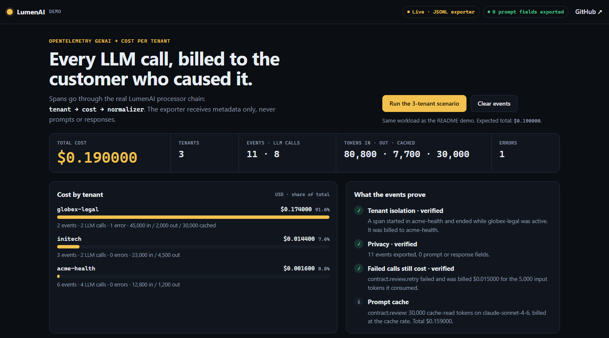
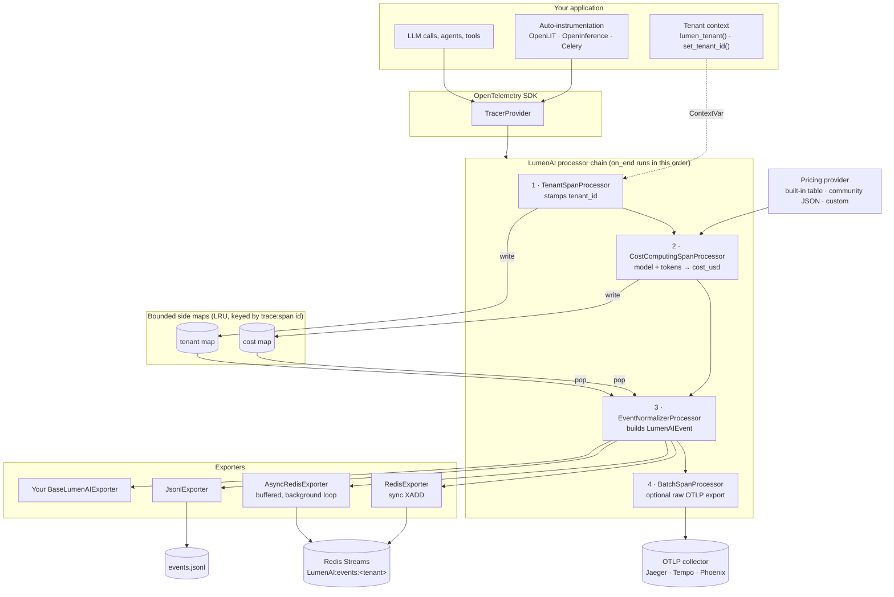
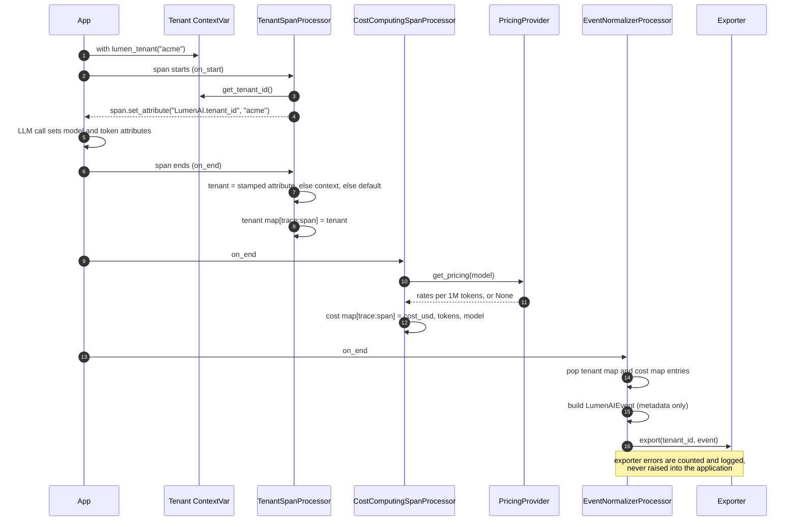
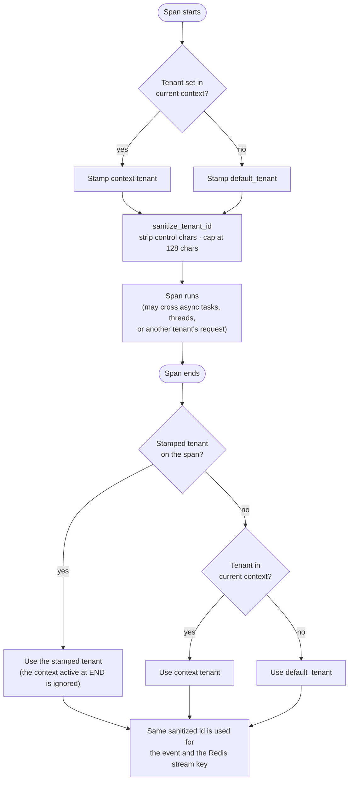
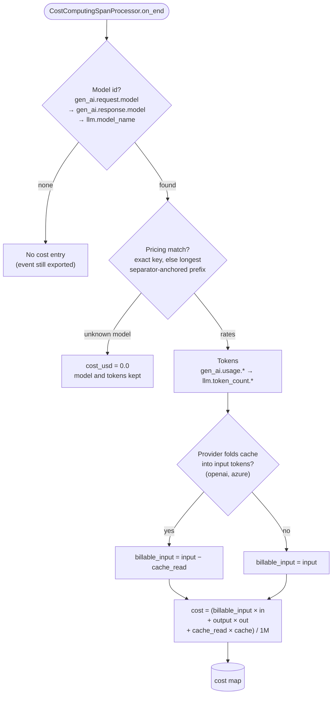
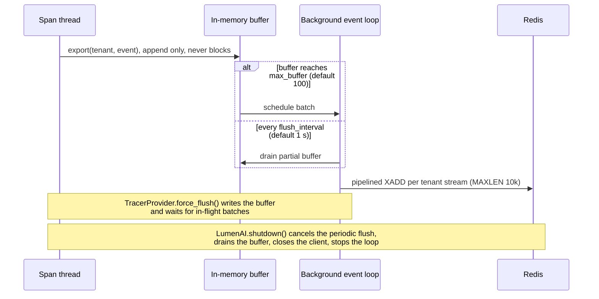

# LumenAI SDK

**Metadata-only FinOps and observability for Generative AI.** LumenAI is an OpenTelemetry extension for Python that turns GenAI spans into tenant-attributed cost events, so you can answer *which customer caused this LLM bill*, *which model is failing*, and *which background job is burning tokens*, without ever exporting a prompt, a completion, or a tool argument.

[](#status)
[](LICENSE)
[](https://www.python.org/)
[](https://pypi.org/project/lumen-ai-sdk/)
[](https://github.com/skarL007/lumen-ai-sdk/actions/workflows/ci.yml)
[](https://lumen-ai-sdk-demo.vercel.app)

[](https://lumen-ai-sdk-demo.vercel.app)

<sub>**[Open the live demo](https://lumen-ai-sdk-demo.vercel.app)**: the scenario below, run by the real SDK on each request. Every number on it is read from what the exporter received.</sub>

- [Reproducible demo](#reproducible-demo-60-seconds-no-keys)
- [See it in a dashboard](#see-it-in-a-dashboard)
- [How it works](#how-it-works)
- [Quick start](#quick-start)
- [Integrations](#integrations)
- [Event contract](#event-contract)
- [Extending LumenAI](#extending-lumenai)
- [Design decisions](#design-decisions)
- [Development](#development)

## Why

A shared LLM bill tells you *how much* you spent, not *who* spent it. In a multi-tenant product the useful questions are per customer, per model, and per workflow, and the data to answer them already exists in your OpenTelemetry spans: model name, token counts, cache reads, status, duration.

LumenAI reads that metadata and nothing else. It attaches a three-processor chain to your `TracerProvider`, stamps each span with a tenant, prices it, and exports one normalized event per span to Redis Streams, JSON Lines, or your own sink.

| You get | You never export |
|---|---|
| Tenant id, session id, agent id | Prompts or completions |
| Model, input / output / cache-read tokens | Tool arguments |
| `cost_usd` from a pluggable price table | Raw request or response bodies |
| Event type, severity, duration, error flag | API keys or user content |

## Reproducible demo (60 seconds, no keys)

The demo drives a fixed workload for three tenants through the **real** processor chain, writes the events to JSONL, and rebuilds a cost report from that file alone. No Redis, Docker, or API key is needed, and the numbers are deterministic.

```bash
git clone https://github.com/skarL007/lumen-ai-sdk.git
cd lumen-ai-sdk
python -m venv .venv
# Windows: .venv\Scripts\activate    macOS / Linux: source .venv/bin/activate
pip install -e packages/lumen-ai-core
python examples/multi-tenant-cost-report/main.py
```

Expected output, byte for byte (a test keeps this block in sync with the script):

<!-- demo-output:start -->
```text
tenant         events  llm errors  tokens in     out  cached   cost (USD)
-------------------------------------------------------------------------
globex-legal        2    2      1     45,000   2,000  30,000     0.174000
initech             3    2      0     23,000   4,500       0     0.014400
acme-health         6    4      0     12,800   1,200       0     0.001600
-------------------------------------------------------------------------
total              11                                            0.190000

isolation  span started in acme-health, ended in globex-legal -> billed to acme-health
privacy    11 events, 0 prompt/response fields exported
events     .runtime/cost-report.jsonl
```
<!-- demo-output:end -->

What each line proves:

| Line | Behavior under test |
|---|---|
| `globex-legal 0.174000` | Anthropic prompt-cache reads are billed at the cache rate (`40k × $3 + 2k × $15 + 30k × $0.30` per 1M), and the failed retry is still charged for its input tokens. |
| `initech 0.014400` | An OpenInference-only span (Phoenix style, `llm.token_count.*`) is priced like an OTel GenAI span, and the local `ollama/gemma3:12b` call costs `$0`. |
| `acme-health 6 events` | Chat turns, an embedding, a tool call, and a follow-up all land under one tenant. |
| `isolation` | A span that **starts** in one tenant's context and **ends** in another's stays billed to the tenant it started in. |
| `privacy` | No event carries prompt or response content. |

Open `.runtime/cost-report.jsonl` to see the raw events. The script is [examples/multi-tenant-cost-report/main.py](examples/multi-tenant-cost-report/main.py).

## See it in a dashboard

**Live: [lumen-ai-sdk-demo.vercel.app](https://lumen-ai-sdk-demo.vercel.app)**. The same workload, behind a small FastAPI app with a dashboard, hosted on Vercel. Each request runs the SDK on the server and returns the events the exporter received; nothing is stored, so visitors never see each other's spans. The page shows:

- **Cost by tenant**, with the same `$0.190000` total as the report above.
- **What the events prove**: the cross-tenant span billed to `acme-health`, zero prompt or response fields, the failed retry still charged for its input tokens, and the cache-read tokens priced at the cache rate.
- **Exported events**: one row per event, with the raw JSON a click away.
- **Send your own span**: pick a tenant, any model in the price table, and token counts, then see the event LumenAI exports.

To run it on your machine, still with no Docker, Redis, or API key:

```bash
pip install -e packages/lumen-ai-core fastapi uvicorn
uvicorn main:app --app-dir examples/local-observability-demo   # then open http://localhost:8000
```

Locally, events go to a JSONL file and the dashboard reads them back from it. Set `REDIS_URL` (or run `docker compose up --build` in that folder) to store them in Redis Streams instead. `record.py` saves a run to `static/recorded-events.json`; served without the backend, from any static host, the page replays that recording. The API, the Vercel setup, and the other details are in [examples/local-observability-demo](examples/local-observability-demo).

## How it works

### Architecture



Processors communicate through two bounded, thread-safe side maps instead of mutating spans after they end: OpenTelemetry spans are read-only in `on_end`. The normalizer **pops** each entry as it consumes it, so memory stays bounded and a recycled span id can never read stale data.

### Life of one span



### Tenant attribution



The stamped tenant wins on purpose. If the live context were read first, a span that ends while another customer's request is active would be billed to that customer. The demo's `isolation` line exercises exactly this case.

### Cost computation



Prefix matching needs a separator, so `gpt-4o-mini-2024-07-18` resolves to `gpt-4o-mini`, not to the pricier `gpt-4o`, and `notaclaude-x` never matches `claude-*`.

### AsyncRedisExporter



The Redis asyncio client is bound to the loop that created it, so all I/O runs on one dedicated loop and the caller's event loop is never touched.

## Quick start

### Install

```bash
pip install lumen-ai-sdk
# optional
pip install lumen-ai-sdk-celery
pip install lumen-ai-sdk-openlit
```

| Package | Folder | Purpose | Install when |
|---|---|---|---|
| `lumen-ai-sdk` | `packages/lumen-ai-core` | Processors, pricing, event schema, Redis and JSONL exporters, tenant helpers | Always |
| `lumen-ai-sdk-celery` | `packages/lumen-ai-celery` | Celery signal instrumentation for task lifecycle spans | You run Celery workers |
| `lumen-ai-sdk-openlit` | `packages/lumen-ai-openlit` | Points OpenLIT auto-instrumentation at the LumenAI tracer provider | You want provider/framework auto-instrumentation |

The import names are `lumen_ai`, `lumen_ai_celery` and `lumen_ai_openlit`. Versions up to `0.1.3` were published as `lumen-ai-core`, `lumen-ai-celery` and `lumen-ai-openlit`; those names get no new releases. To run the latest `main`, install from Git:

```bash
pip install "git+https://github.com/skarL007/lumen-ai-sdk.git#subdirectory=packages/lumen-ai-core"
```

### JSON Lines (no services)

```python
from opentelemetry import trace

from lumen_ai import JsonlExporter, LumenAI, lumen_tenant
from lumen_ai.schema.semconv import GenAIAttributes, OpenInferenceAttributes, SpanKind

LumenAI.init(
    service_name="my-ai-app",
    exporter=JsonlExporter("lumen-events.jsonl"),
    default_tenant="anonymous",
)

tracer = trace.get_tracer("my-ai-app")

with lumen_tenant("client-acme"):
    with tracer.start_as_current_span("llm.chat") as span:
        span.set_attribute(OpenInferenceAttributes.SPAN_KIND, SpanKind.LLM)
        span.set_attribute(GenAIAttributes.REQUEST_MODEL, "gpt-4o-mini")
        span.set_attribute(GenAIAttributes.USAGE_INPUT_TOKENS, 1200)
        span.set_attribute(GenAIAttributes.USAGE_OUTPUT_TOKENS, 300)

LumenAI.shutdown()
```

In real applications the model and token attributes come from auto-instrumentation (OpenLIT, OpenInference). You only set the tenant.

### Redis Streams

```python
from lumen_ai import AsyncRedisExporter, LumenAI

# Simple, synchronous XADD per span:
LumenAI.init(service_name="my-ai-app", redis_url="redis://localhost:6379/0")

# Or non-blocking, for latency-sensitive paths:
LumenAI.init(
    service_name="my-ai-app",
    exporter=AsyncRedisExporter("redis://localhost:6379/0", max_buffer=100, flush_interval=1.0),
)
```

Each tenant gets its own stream, `LumenAI:events:<tenant_id>`, so a consumer can be scoped to one customer.

### Tenant context

```python
from lumen_ai import lumen_tenant, reset_tenant_id, set_tenant_id

with lumen_tenant("client-acme"):      # request-scoped code
    run_llm_call()

token = set_tenant_id("client-acme")   # middleware
try:
    handle_request()
finally:
    reset_tenant_id(token)
```

Tenant ids are sanitized once, the same way for span attributes, Celery kwargs, and stream keys: control characters are removed and length is capped, which bounds Redis key cardinality.

### Only GenAI spans

Some frameworks emit their own OpenTelemetry spans; FastAPI 0.162, for example, emits request, endpoint, and serialization spans. By default LumenAI exports a span with no GenAI attributes as a generic agent step (`AGENT_COMPLETED`, `$0`). To keep the event stream to GenAI work only:

```python
LumenAI.init(service_name="my-ai-app", exporter=JsonlExporter("lumen-events.jsonl"), genai_only=True)
```

With `genai_only=True`, a span is exported only if it has a model, token counts, a GenAI operation, an OpenInference span kind, a tool name, or a LumenAI agent id. Skipped spans are counted in `events_skipped` from `lumen_ai.processors.normalizer.get_metrics()`.

## Integrations

| Integration | How | Example |
|---|---|---|
| FastAPI | Set the tenant in middleware or a dependency, reset in `finally`; add `genai_only=True` to drop FastAPI's own spans | [examples/fastapi-quickstart](examples/fastapi-quickstart), [examples/local-observability-demo](examples/local-observability-demo) |
| Celery | `CeleryInstrumentor`; pass `tenant_id=` as a task kwarg | [examples/celery-background-tasks](examples/celery-background-tasks) |
| OpenLIT / LangChain | `instrumentors=[OpenLITBridge()]` in `LumenAI.init()` | [examples/langchain-cost-tracking](examples/langchain-cost-tracking) |
| OTLP backends | `enable_otlp=True, otlp_endpoint=...`; TLS is automatic for non-loopback hosts | — |
| Existing OTel setup | `LumenAI.init()` adopts an already-installed `TracerProvider` instead of replacing it | — |

## Event contract

Every exporter receives `export(tenant_id, event)` where `event` is a `LumenAIEvent`:

| Field | Type | Source |
|---|---|---|
| `id` | `str` | UUID4 per event |
| `tenant_id` | `str` | Tenant attribution (see above) |
| `session_id` | `str` | `LumenAI.session_id`, else `gen_ai.conversation.id` |
| `agent_id` | `str` | `LumenAI.agent_id`, else `gen_ai.agent.id` |
| `trace_id`, `span_id` | `str` | OTel ids, hex |
| `timestamp` | `str` | Span **end** time, ISO-8601 UTC |
| `event_type` | `str` | `LLM_CALL_COMPLETED`, `TOOL_CALL_FAILED`, `EMBEDDING_COMPLETED`, … |
| `severity` | `str` | `INFO` or `ERROR` |
| `message` | `str` | Span name |
| `duration_ms` | `int` | End − start |
| `is_error` | `bool` | Span status is `ERROR` |
| `cost_usd` | `float` | `0.0` when the model has no price |
| `tokens_in`, `tokens_out`, `cache_read_tokens` | `int` | GenAI usage, else OpenInference counts |
| `model`, `tool_name`, `span_kind` | `str` | Span attributes |

The schema has no field that can carry prompt, completion, request-body, or tool-argument content.

```json
{"tenant_id":"globex-legal","event_type":"LLM_CALL_COMPLETED","severity":"INFO","message":"contract.review","model":"claude-sonnet-4-6","tokens_in":40000,"tokens_out":2000,"cache_read_tokens":30000,"cost_usd":0.159,"is_error":false,"span_kind":"LLM","...":"..."}
```

## Extending LumenAI

### Custom exporter

```python
from lumen_ai.providers import BaseLumenAIExporter
from lumen_ai.schema.event_types import LumenAIEvent


class ClickHouseExporter(BaseLumenAIExporter):
    def export(self, tenant_id: str, event: LumenAIEvent) -> None:
        self._buffer.append((tenant_id, event))      # must not raise, must be fast

    def force_flush(self, timeout_millis: int | None = None) -> bool:
        return self._write_buffer(timeout_millis)    # reached by TracerProvider.force_flush()

    def shutdown(self) -> None:
        self._write_buffer(None)
        self._client.close()
```

See [examples/custom-exporter](examples/custom-exporter).

### Custom pricing

```python
from lumen_ai import LumenAI
from lumen_ai.providers import BasePricingProvider


class ContractPricing(BasePricingProvider):
    def get_pricing(self, model: str):
        # USD per 1M tokens; return None for unknown paid models, never a fake $0
        return {"input": 0.15, "output": 0.60, "cache_read": 0.03}


LumenAI.init(pricing_provider=ContractPricing())
```

`CommunityPricingProvider(url)` loads a remote JSON price table: HTTPS only by default, 1 MiB cap, JSON-object validation, and a one-hour back-off after success or failure.

## Design decisions

| Decision | Why | Trade-off |
|---|---|---|
| Metadata only, by schema | Cost attribution needs counts, not content; a field that does not exist cannot leak | No content-level debugging; pair with a tracing backend if you need it |
| Span processors, not a wrapper SDK | Works with any instrumentation that emits OTel spans | Relies on emitters setting standard attributes |
| Side maps between processors | Spans are immutable in `on_end`; maps are bounded LRU and popped on read | ~50k in-flight entries max per map |
| Stamped tenant wins at `on_end` | Prevents cross-tenant billing when a span ends in another request's context | Tenant must be set before the span starts |
| Unknown model → `$0`, metadata kept | Never invent a price; never drop the event | Under-reports cost until the price table is updated |
| Exporter errors are swallowed and counted | Telemetry must never take the application down | Failures surface through `lumen_ai.processors.normalizer.get_metrics()` and logs, not exceptions |
| Async exporter on its own event loop | Redis asyncio clients are loop-bound; the caller's loop is never blocked | One background thread per exporter |

## Status

Alpha. The core contracts are covered by tests and usable for evaluation and early integration; public names may still change before 1.0.

| Area | State |
|---|---|
| Core processors, exporters, tenant isolation | Covered by unit, integration, and regression tests |
| Release gate | `scripts/release_gate.py`: tests, ruff, mypy, wheel and sdist builds, `twine check`, clean installs, `pip check` |
| PyPI | `lumen-ai-sdk`, `lumen-ai-sdk-celery` and `lumen-ai-sdk-openlit` from `0.1.4`; `0.1.3` and older as `lumen-ai-core`, `lumen-ai-celery` and `lumen-ai-openlit` |
| Storage models | SQLAlchemy models with tenant-scoped constraints for new schemas; no Alembic migrations yet |
| Dashboard | [Live demo](https://lumen-ai-sdk-demo.vercel.app) on Vercel, plus local JSONL and Redis modes and a static replay; not a hosted control plane |

Roadmap: richer exporter examples (ClickHouse, Postgres, Kafka), an OpenLIT compatibility matrix, a production dashboard example, then a stable 1.0 API with a migration guide.

## Development

```bash
python -m venv .venv && source .venv/bin/activate   # Windows: .venv\Scripts\activate
pip install -e packages/lumen-ai-core -e packages/lumen-ai-celery -e packages/lumen-ai-openlit
pip install pytest pytest-cov fastapi httpx ruff mypy build twine pip-audit celery

python -m pytest tests -q
python -m ruff check packages/lumen-ai-core/src packages/lumen-ai-celery/src packages/lumen-ai-openlit/src examples tests --select E,F,W,I --ignore E501
python -m mypy packages/lumen-ai-core/src/lumen_ai --ignore-missing-imports
python scripts/release_gate.py            # full gate, run before any PR
```

Redis-backed integration tests run when `redis://localhost:6379` is reachable and are skipped otherwise. Benchmarks are opt-in with `LUMEN_RUN_BENCHMARKS=1`.

Releases go through GitHub Trusted Publishing (`.github/workflows/publish.yml`), never from a laptop. See [RELEASE_CHECKLIST.md](RELEASE_CHECKLIST.md). A local audit harness (`harness/scripts/run-audit.ps1 -Full`) produces a scored report and dashboard for release reviews.

## Security

LumenAI exports metadata only, namespaces Redis streams per tenant, sanitizes tenant ids, defaults OTLP to TLS for remote endpoints, and restricts remote pricing to HTTPS with a size cap. Report vulnerabilities privately as described in [SECURITY.md](SECURITY.md).

## Contributing

Start with [CONTRIBUTING.md](CONTRIBUTING.md). Good first contributions: model prices with an official source link, framework examples, exporters for other sinks, and OpenLIT/LangChain compatibility coverage.

## License

MIT. See [LICENSE](LICENSE).
